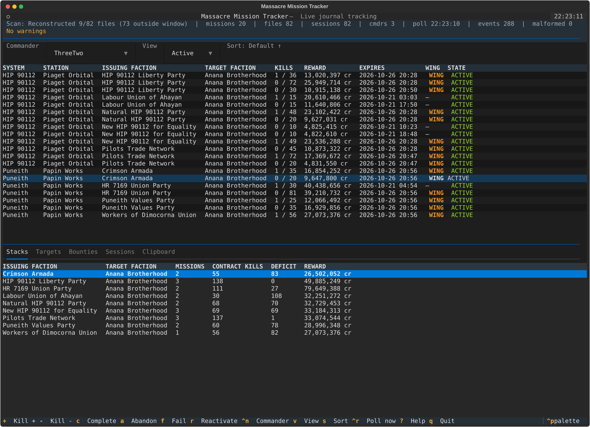
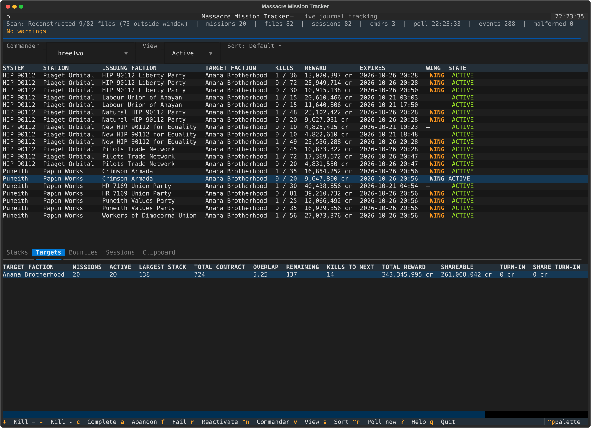

# Elite Dangerous Massacre Mission Tracker

A stateless, live-only terminal tracker for Elite Dangerous massacre missions.
It reconstructs recent mission state from journal files, then follows every
journal file in a directory in real time.

All game state lives in memory. The application never creates a database, a
mission-state file, a cache, a log file, or a clipboard file, and it writes
nothing on exit.

This is an independent clean-room implementation based on the project's
specification and public Elite Dangerous journal documentation. It does not
reuse code, text, identifiers, or assets from any other massacre mission
tracker.

---

## Features

- Reconstructs the last 8 days of mission state at startup.
- Tails every `Journal.*.log` file in a directory, including:
  - new lines appended to known files,
  - files created after startup,
  - files that are truncated or replaced.
- Tracks multiple concurrent sessions and multiple commanders.
- Automatically selects the commander from the newest journal at startup and
  when a new journal file appears. Manual commander selection takes precedence
  until another journal appears.
- Shares mission state between files belonging to the same commander while
  keeping station context separate per file.
- Automatically credits `Bounty` events to the oldest eligible mission in each
  issuing/target stack, one mission per stack per bounty.
- Provides stack and target-faction summaries, including overlap and reward
  averages.
- Shows the last 20 eligible bounties per commander.
- Includes manual kill adjustments, manual state changes, mission deletion, and
  an in-memory source clipboard.
- Ignores Legacy (major version 3) sessions for tracking and provides no Legacy
  view.
- Handles partial lines, malformed JSON, missing files, and concurrent appends.
- Works at 100×30 and degrades gracefully at 80×24.

---

## Requirements

- Python 3.11 or newer
- [Textual](https://textual.textualize.io/) (installed automatically)
- Elite Dangerous Live journal files

## Installation

```bash
python3 -m venv .venv
. .venv/bin/activate
pip install -e .
```

For development and tests:

```bash
pip install -e '.[dev]'
python -m pytest
```

## Usage

Point the tracker explicitly at the directory containing `Journal.*.log` files:

```bash
massacre-tracker --journal-dir "/path/to/Elite Dangerous"
```

The directory can also be supplied with an environment variable:

```bash
export ED_JOURNAL_DIR="$HOME/.local/share/Steam/steamapps/compatdata/359320/pfx/drive_c/users/steamuser/Saved Games/Frontier Developments/Elite Dangerous"
massacre-tracker
```

Typical journal locations:

- **Windows:** `%USERPROFILE%\Saved Games\Frontier Developments\Elite Dangerous`
- **Linux/Steam Proton:** inside the game's Proton prefix, under
  `drive_c/users/<user>/Saved Games/Frontier Developments/Elite Dangerous`
- **Steam/Epic installs:** use the path shown by the game or launcher.

Automatic journal-directory detection is not performed. An explicit path is
required.

### Command-line options

| Option | Description |
|---|---|
| `--journal-dir PATH` | Directory containing `Journal.*.log`. Falls back to `ED_JOURNAL_DIR`. |
| `--days N` | Days of journals to reconstruct at startup. Default `8`. |
| `--poll SECONDS` | Directory polling interval. Default `2.0`. |
| `--commander FID_OR_NAME` | Initially select a commander by FID or name (case-insensitive). |
| `--no-color` | Install a monochrome output filter. |

### Keyboard shortcuts

| Key | Action |
|---|---|
| `+` / `-` | Increment or decrement the selected mission |
| `]` / `[` | Increment or decrement one mission in every issuing/target stack |
| `c` | Mark selected mission completed |
| `a` | Mark selected mission abandoned |
| `f` | Mark selected mission failed |
| `r` | Mark selected mission active again |
| `delete` | Delete selected mission from memory |
| `y` | Add selected mission source to the in-memory clipboard |
| `shift+y` | Open the copy menu for source system, source station, or destination |
| `ctrl+y` | View the in-memory clipboard |
| `ctrl+x` | Clear completed/abandoned/failed missions from memory |
| `ctrl+n` | Switch to the next commander |
| `v` | Switch between Active and Completed views |
| `s` | Cycle sort key |
| `shift+s` | Toggle sort direction |
| `ctrl+r` | Poll the journal directory immediately |
| `?` | Open help |
| `q` | Quit |

Manual edits are in memory only. They are lost when the application exits, and
the next startup reconstructs state from the journal files again.

---

## What is tracked

### Mission eligibility

A `MissionAccepted` event creates a tracked mission only when all of these are
true:

1. The session is Live (`Fileheader.gameversion` major version ≥ 4), or its
   liveness is unknown and has been treated as Live with a warning.
2. The session has a known current station.
3. `KillCount` is present and greater than zero.
4. `TargetFaction` is present and non-empty.
5. `TargetType` contains `MissionUtil_FactionTag_Pirate`, case-insensitively.

Mission name, localised name, reward, and wing status are not filters.
Duplicate mission IDs are idempotent.

Source system, system address, and source station are taken from the session's
station at the moment the event was read. Sessions share commander mission
state, but never share station context.

### Mission states

- `ACTIVE` — tracked and participating in its stack.
- `REDIRECTED` — kill requirement met; no longer in its stack, but included in
  target summaries.
- `COMPLETED` — completed; reward replaced by the completion event reward.
- `ABANDONED` — reward zero.
- `FAILED` — reward zero.

Expiry is informational only and never changes state automatically.

### Kill credit

Only eligible `Bounty` events credit missions. A bounty is ignored when any of
the following is true:

- `VictimFaction` contains `faction_none` (case-sensitive).
- `VictimFaction` contains `faction_Pirate` (case-sensitive).
- `Target` contains `suit` (case-sensitive).
- `TotalReward` is zero or negative.

For every issuing/target stack matching `VictimFaction` case-insensitively, the
oldest `ACTIVE` mission below its contract is incremented by one. A single
bounty can credit one mission in each stack, but never two missions in the same
stack. Reaching `contract_kills` immediately changes the mission to
`REDIRECTED`.

### Summaries

- **Stack summary:** groups `ACTIVE` missions by issuing faction and target
  faction. Deficit is the difference between the largest contract total for
  that target faction and this stack's total.
- **Target summary:** includes `ACTIVE` and `REDIRECTED` missions. It reports
  the largest stack contract, total contract, overlap ratio, remaining
  required kills, oldest-active kills-to-next-completion, reward totals, and
  rounded reward averages.
- **Ready to turn in:** a `REDIRECTED` mission whose source station name matches
  any station currently occupied by a session for the same commander,
  case-insensitively. This is derived state and is never stored on the mission.

### Sessions and commanders

- A journal file is a session.
- The commander belonging to the newest journal (by file modification time) is
  selected automatically at startup. When a new journal file appears, its
  commander becomes active once its `Commander` event has been read.
- Manual commander selection is respected until another new journal appears.
- Mission, stack, target, and bounty-feed state belongs to the commander (`FID`).
- Multiple files with the same FID share mission state but keep separate
  station context, offsets, partial buffers, and liveness.
- If a file has no `Commander` event yet, gameplay events are buffered. At end
  of replay, or after a fallback timeout during live tailing, the file is
  assigned a deterministic unknown commander key derived from its filename.
  A later `Commander` event migrates that state to the real FID.
- Legacy files remain visible as sessions but never affect missions or kills.

---

## Stateless behavior

At startup the application:

1. Discovers `Journal.*.log` files.
2. Includes a file when its filename timestamp or modification time is within
   the configured window.
3. Reads included files only up to their observed size at scan start.
4. Applies relevant events globally ordered by timestamp, filename, and line
   number.
5. Sets each file's live-tail offset to the exact byte position reached.
6. Starts polling every file, including files outside the reconstruction
   window.

Files outside the window are watched from their current size; only data
appended after startup is processed.

Nothing is persisted. On restart, state is reconstructed again. Manual mission
changes, deletions, sort state, selections, and clipboard contents are gone.

---

## Interpretation decisions

The specification leaves a few details open. This implementation chooses:

- Ready-to-turn-in compares **station name only**, not station plus system.
- Unknown expiry is displayed as `—` and sorts after known expiries in both
  directions.
- Faction grouping is case-insensitive. Display uses the spelling from the
  oldest mission in the group.
- Reward averages use half-up rounding to whole credits.
- Unknown commander keys are `__unknown__:<journal filename>`.
- Manually marking a mission abandoned or failed also zeroes its reward, matching
  the corresponding journal events.
- `Missions` reconciliation follows the specification literally: any tracked
  mission ID not listed in `Active`, `Complete`, or `Failed` becomes
  `COMPLETED`, and no missions are created.
- During startup reconstruction, `Fileheader`, `Commander`, and station events
  from before the cutoff are still read to establish session liveness, identity,
  and current station. Mission, bounty, and reconciliation events before the
  cutoff are ignored.
- A missing `Fileheader` is treated as Live with a warning.
- New live files with no `Fileheader` use a 10-second fallback before being
  treated as Live with an unknown commander.
- Per-session hashes of applied gameplay lines survive truncation so a
  reprocessed file cannot double-credit bounties.
- The application offers no combined cross-commander view. One commander is
  shown at a time.
- The Sessions tab labels a session `ACTIVE` when it has emitted an event in the
  last five minutes, otherwise `IDLE`.
- `ctrl+r` performs an immediate poll / rediscovery. A destructive full rebuild
  is not exposed in the UI.
- The clipboard is held in memory and displayed in the Clipboard tab. Copy
  actions may also use the terminal/OS clipboard; no file is written.

---

## Diagnostics and troubleshooting

The status area shows the number of missions in the current view after filtering
and sorting, plus the watch count, active sessions, commander count, scan
progress, last poll time, processed event count, and malformed-line count. The
Sessions tab lists every file, its commander, current station/system, last event
age, and Live/Legacy/Unknown and Active/Idle state. The configured journal path
is not shown in the main view; it appears only on the startup error screen if
the directory cannot be used.

Common situations:

- **Journal directory unavailable:** a clear error screen shows the configured
  path and offers Retry or Quit.
- **No journal files:** the UI stays open and polling continues, so files
  created later are picked up automatically.
- **Malformed lines:** skipped and counted; the application keeps running.
- **Missing or unreadable files:** reported in the warnings line. Other files
  continue to be watched.
- **Unknown commander warning:** no `Commander` event was found; a deterministic
  fallback key is used.
- **No Fileheader warning:** the session is treated as Live on a best-effort
  basis.
- **No Legacy missions:** expected. Legacy sessions are not tracked.
- **Mission disappeared after restart:** manual deletions are not persisted;
  journal events reconstruct the mission again.

---

## Limitations

- Live sessions only. Legacy/Horizons 3.x is watched but never tracked.
- No persistence, import, or export of mission state.
- No mission-board scraping, route planning, trade, exploration, engineering,
  fleet-carrier, or network features.
- Historical missions older than the 8-day reconstruction window are not
  reproduced, except for files kept in the window by recent modification time.
- Expiry is display-only.
- Ready-to-turn-in uses station name only, as specified.
- No combined cross-commander view.
- Manual edits and clipboard contents are intentionally lost on exit.

---

## Development

Run the full test suite:

```bash
python -m pytest
```

Run the specification acceptance tests:

```bash
python -m pytest tests/test_acceptance.py -v
```

Tests use synthetic journal fixtures under temporary directories; they never
touch a real game journal directory.

A synthetic scan benchmark is available:

```bash
python scripts/bench_scan.py --lines 500000 --files 8
```

### Project layout

```text
src/massacre_tracker/
    cli.py, config.py, engine.py
    domain/        mission model, eligibility, lifecycle, kills, summaries
    journal/       discovery, parser, byte reader, scanner, tailer
    ui/            Textual app, screens, formatting, clipboard, stylesheet
tests/             unit, integration, UI smoke, and acceptance tests
```

---

## License

This project is released into the public domain under the Unlicense. See
[`LICENSE`](LICENSE).

---

## Screenshots




